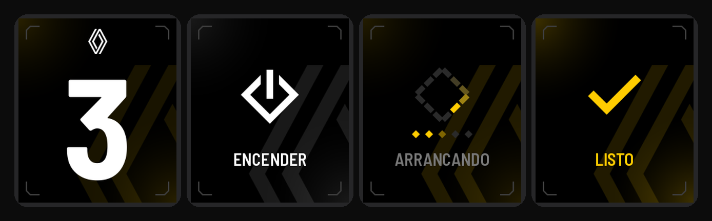
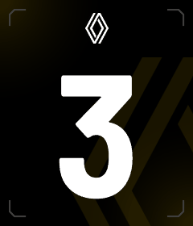
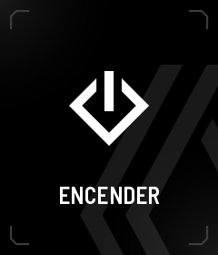
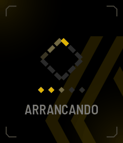
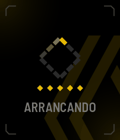
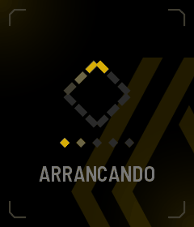

# Gear Dash — a smart gear-knob display for a 1988 Renault 9

A 1.69" touchscreen mounted on top of the gear lever of a Renault 9. It detects the selected gear **with an
accelerometer** (no sensors on the gearbox) and shows it big enough to read at a glance. A long press opens a
one-button menu that starts or stops the car remotely.



<p align="center">
  
  
  
  
</p>

## Highlights

- **Gear detection with an IMU.** A guided calibration records a cloud of tilt samples per gear (N, 1/R, 2, 3, 4, 5);
  at runtime the gear whose cloud is closest wins, but only once the gyro says the lever has settled and the reading
  has been stable for 150 ms, so a hand resting on the knob doesn't change gears.
- **Safety-first interaction design.** Driving means accidental touches, so:
  - opening the menu requires a 0.6 s hold *and* a lever that has been still for 0.7 s;
  - every action requires a 1 s hold with a closing frame, and releasing early cancels;
  - nothing is ever sent unless the car's state has been confirmed; the result is verified after each sequence;
  - the menu always falls back to the gear view on its own.
- **Phone-as-key.** Starting the car requires a paired phone nearby (BLE) or a backup PIN pad. Stopping is always allowed.
- **Custom renderer, no UI framework.** Drawn directly with LovyanGFX into a framebuffer: angular gear glyphs,
  additive glow, sweeping light bands and eased animations, all generated from a token file
  ([`src/tokens.h`](src/tokens.h)) that is the single source for colors, sizes, timings and touch filters.
- **Designed before coded.** Every state was mocked up and animated in Python first
  ([`gear_dash_menu/tools`](gear_dash_menu/tools)), then implemented to match. The full spec is in
  [`gear_dash_menu/design/gear_menu.md`](gear_dash_menu/design/gear_menu.md).
- **Self-tests on boot.** The pure logic (touch filter, PIN pad, timeouts, sequences) lives in
  [`src/logic.h`](src/logic.h) with no hardware dependencies and runs `logic::selfTest()` at startup.

## All states


| Error | Cancelled |
|---|---|
|  |  |

## Public build vs. the one in my car

This repository is a **demo build**: the vehicle link and the BLE phone key are replaced with simulations
([`src/car_link.cpp`](src/car_link.cpp), [`src/phone_key.cpp`](src/phone_key.cpp)) that keep the exact same interfaces,
job queue and verification logic. The real transport to the car controller (an authenticated, encrypted radio
protocol) and the phone-key implementation are kept private for obvious reasons.

The demo is fully interactive on the board: the gear view, menu, hold-to-confirm, loading sequence, success/error
states, PIN pad and phone pairing flow all work.

## Stack

| Layer | Stack |
|---|---|
| Hardware | Waveshare ESP32-S3-Touch-LCD-1.69 (240×280, CST816T touch, QMI8658 IMU) |
| Firmware | PlatformIO · Arduino core 3.x (pioarduino) · LovyanGFX · FreeRTOS tasks |
| Design tooling | Python + Pillow: icons (SVG/PNG), glow maps, glyphs, mockups and GIFs |

## Build

```bash
pio run -t upload
pio device monitor     # 115200
```

Optional: copy `src/secrets.example.h` to `src/secrets.h` to change the backup PIN (default `0000`).

**BOOT** button: short press rotates the screen 180°, hold 1.5 s to recalibrate the gears.

## Layout

```
src/               firmware
  logic.h          hardware-free logic + self-tests
  tokens.h         design tokens (color, size, motion, filters)
  gear.*           IMU gear detection + calibration
  ui.*, fx.*       screens and effects
  car_link.*       vehicle link (simulated in this build)
  phone_key.*      phone key (simulated in this build)
gear_dash_menu/    design spec, icons, mockup and animation generators
tools/             glyph, logo and UI asset generators
docs/              README images
```

## License

[MIT](LICENSE)
