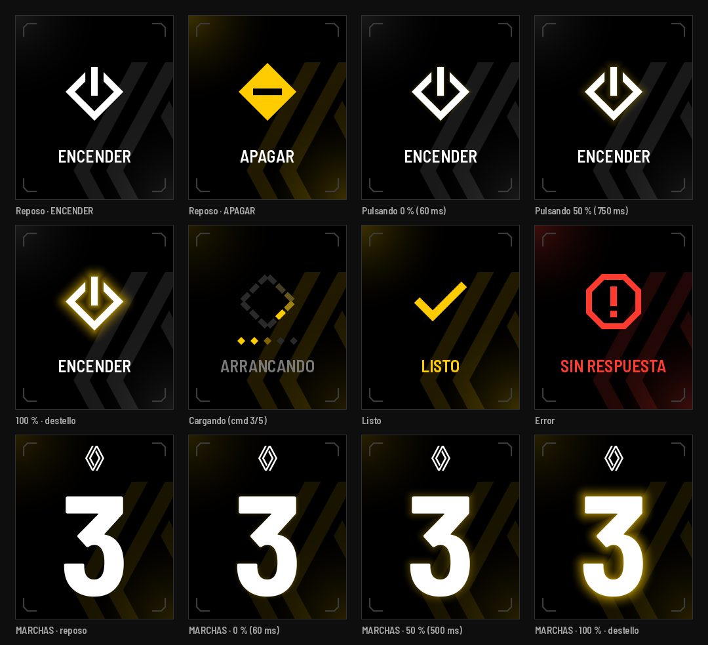
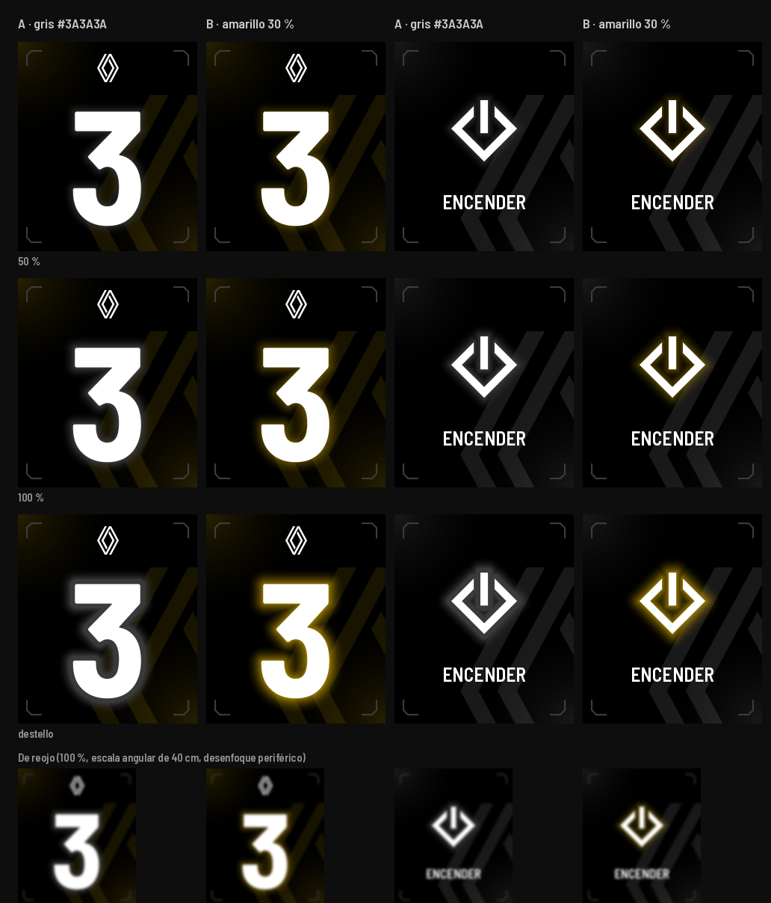

# Gear Dash — señales del menú

Pantalla 240×280 (ST7789, RGB565). Fondo negro puro. Lectura de reojo a ~40 cm.
Todo lo que sigue está en px del panel, ms y valores de 8 bits.



---

## 1. Paleta

| Rol | Hex | RGB565 | Uso |
|---|---|---|---|
| Fondo | `#000000` | `0x0000` | Pantalla |
| Tinta | `#FFFFFF` | `0xFFFF` | Números, ícono ENCENDER, etiquetas |
| Acento | `#FFCC00` | `0xFE60` | Estado encendido (APAGAR), LISTO, carga, sombra de pulsación |
| Error | `#FF3B30` | `0xF9C6` | Ícono y etiqueta de ERROR, halo de error |
| Apoyo | `#787878` | `0x7BCF` | Etiqueta "ARRANCANDO", logo en reposo |
| Marca HUD | `#3C3C3C` | `0x39E7` | Marcas de esquina del MENÚ (2 px) |
| Pista | `#2A2A2A` | `0x2945` | Segmentos apagados de la carga, comandos pendientes |
| Sombra pico | `#FFCC00` × 30 % = `#4D3D00` | `0x49E0` | Borde de la sombra a 100 % (sobre negro) |
| Destello pico | `#FFCC00` × 54 % = `#8A6E00` | — | Borde de la sombra en el destello |

## 2. Fondo y botón (MENÚ y MARCHAS)

Sin placa: toda la pantalla es el botón. El fondo es negro con **luz ambiental desde dos esquinas opuestas**
(arriba-izquierda y abajo-derecha) y **marcas HUD** en las cuatro esquinas. Futurista por las marcas y la diagonal;
premium porque es casi imperceptible y el color de la luz cuenta el estado del auto sin texto.

- **Luz de esquina:** mapa `icons/fondo_esquina.png` (140×140, L8): `a = (1 − r/140)^1,8`, `r` = distancia a la esquina.
  Se dibuja arriba-izquierda tal cual y abajo-derecha espejado en X e Y. Mezcla **aditiva** (es luz):
  `pixel += color × opacidad × a`.

  | Estado | Color | Opacidad pico |
  |---|---|---|
  | ENCENDER (auto apagado) | `#FFFFFF` | 10 % |
  | APAGAR (auto encendido) | `#FFCC00` | 24 % |
  | Cargando | `#FFCC00` | 14 %, respira ×0,6–1,0 (coseno, período 1920 ms) |
  | LISTO | `#FFCC00` | 24 % |
  | ERROR | `#FF3B30` | 24 % |

  Cambio de estado: fundido de 300 ms entre colores (ease-in-out).
- **Logo de fondo (rombo Renault, traslúcido):** sale por la esquina de abajo a la derecha, la misma esquina de donde
  viene la luz, así que se lee como si la luz lo iluminara. Cortado por el borde, sus trazos quedan como chevrones
  detrás del botón y no compiten con el ícono (centrado, rombo sobre rombo, sí compite).
  Máscara `icons/logo_fondo.png` (152×209, L8, ya recortada a lo visible), se dibuja en **(88, 71)**, mezcla aditiva:
  blanco al 10 % con el auto apagado; color del estado al 13 % en los demás (amarillo / rojo).
  Escala: el rombo completo mediría 330 px de alto. Variantes comparadas en `logo_fondo_variantes.png`.
- **Marcas HUD:** en cada esquina, a 12 px del borde, una "L" de brazos de 20 px, trazo 2 px, con la punta
  cortada a 45° (chaflán 6 px), color `#3C3C3C`. Las cuatro son espejos de la de arriba-izquierda.
- La luz de esquina es fondo, no un elemento: arranca en el borde a propósito. Todo lo demás respeta los 12 px.
- **MARCHAS usa el mismo fondo:** luz de esquina, marcas HUD y logo traslúcido en la misma posición. La luz es
  ámbar al **16 %** con el motor en marcha (más baja que en el MENÚ para no molestar de noche) y blanca al 10 % con el
  motor apagado; el logo traslúcido va al 10 % en el color de la luz.
- **Logo de MARCHAS:** el rombo de la marca (sin el texto), `icons/logo_marchas.png` 29×38 L8, en **(106, 16)**, en
  `#FFFFFF`. Reemplaza al marcador de los mockups anteriores.
- Ícono: 96×96 centrado en (120, 116) → esquina superior izquierda en (72, 68).
- Halo / sombra: 168×168 centrado en el mismo punto → esquina en (36, 32).
- Etiqueta (firmware): Bahnschrift SemiBold SemiCondensed 26 px, centrada en y = 214.
- Margen mínimo real medido en todos los mockups: 15–16 px (regla: ≥ 12).

## 3. Íconos

Familia común: trazo **10 px** (tilde 12 px), sin curvas, terminaciones a 45°, todo derivado del rombo.
Máscara 96×96 (blanco = opaco) en `icons/<nombre>.png`; el firmware tiñe.

| Ícono | Forma | Color | Por qué |
|---|---|---|---|
| **ENCENDER** `encender.png` | Rombo hueco (semidiagonal 44) abierto arriba (abertura 28 px) + barra vertical 10×44 que entra por la abertura | `#FFFFFF` | La barra "I" entra en el rombo: contacto. El corte vertical sobre el brazo a 45° deja el bisel de 45°. Es contorno: liviano, "apagado". |
| **APAGAR** `apagar.png` | Rombo macizo (semidiagonal 44) con ranura horizontal 44×10 al centro | `#FFCC00` | La misma barra, acostada: contacto cortado. Macizo y amarillo = encendido. Se distingue de ENCENDER por masa y color, sin leer. |
| **ERROR** `error.png` | Placa octogonal 84×84 (esquinas a 45° de 24 px), trazo 9, "!" de barra 10×30 + punto 10×10 | `#FF3B30` | Silueta distinta de los rombos para que no se confunda; la forma es la de la placa del botón. |
| **LISTO** `listo.png` | Tilde de dos brazos exactos a 45° y −45°, trazo 12, unión en inglete | `#FFCC00` | Totalmente angular; acento = acción completada. |

Variante de contraste: `contraste_40cm.png`. A 218 ppi, 96 px = 11,2 mm → 1,6° a 40 cm (≈ 63 px en un monitor a 60 cm).
Los cuatro se distinguen por silueta también desenfocados (fila "de reojo").

## 4. Sombra de pulsación (indicador de PULSACIÓN)

### 4.1 Decisión de color: **amarillo al 30 %**



- **A, gris `#3A3A3A`:** sobre negro aparece, pero se lee como un número *desenfocado*: ensucia el borde blanco
  justo lo que hay que evitar. Con la luz de esquina blanca del MENÚ se confunde con el fondo.
- **B, amarillo 30 % (`#4D3D00` en el borde):** misma luminancia que el gris (~4–5 %), pero con tono: se lee como
  luz *detrás* del número, no como borde borroso. El número queda limpio y nítido. Además, amarillo ya significa
  "progreso / acción" en el sistema.
- Recomendación: **B**. El gris queda descartado.

### 4.2 Forma

Halo que sigue la silueta: no se desenfoca en tiempo real, se usa un **mapa de sombra** precalculado por forma
(`*_glow.png`, 8 bits): `v = 255` dentro de la forma; afuera `v = 255·(1 − d/24)`, con `d` = distancia al borde en px.
Para los números de marcha y el logo se genera igual con `tools/make_shadow.py <máscara> <salida>`.

Por frame, con `I` (intensidad) y `R` (expansión):

```
d(v)   = 24 · (1 − v/255)                       // distancia al borde, px
g(d)   = clamp(1 − d / (6 + R), 0, 1)²          // caída cuadrática ≈ desenfoque gaussiano
alpha  = 0,30 · I · g(d)                         // 0,30 = A_max amarillo
color  = mezcla(fondo, #FFCC00, alpha)
```

Se calcula una **LUT de 256 entradas** por frame (`v → alpha`) y se recorre el mapa (168×168 = 28 k px) mezclando
cada pixel con lo que ya hay en el framebuffer; después se pinta el número/ícono encima con su alpha. Como las dos
pantallas tienen luz de esquina y logo de fondo, se mezcla siempre contra el pixel existente (28 k mezclas por frame:
nada para el ESP32-S3).

- Extensión en reposo del halo: 6 px. Expansión: **0 → +12 px** (alcance total 18 px). Destello: hasta +16 (22 px).
- Nunca pasa de 24 px (límite del mapa) → no invade el margen de 12 px.

### 4.3 Tiempos y curvas

`T` = 1000 ms (abrir menú, sobre logo o número) · 1500 ms (ejecutar, sobre el botón). `p = t / T`, `t` desde el toque.

| Fase | Tiempo | Intensidad `I` | Expansión `R` |
|---|---|---|---|
| Rebote | 0–60 ms | 0 (nada) | — |
| Aparece | 60 ms | salta a 0,40 + 0,60·p (≈ 0,43) | ease-out: 12·(1 − (1 − p)²) |
| Progreso | 60 ms → T | **lineal** 0,40 → 1,00 | ease-out → 12 px |
| Destello (completado) | T → T+60 ms | 1,0 → 1,8 (borde ≈ `#8A6E00`) | 12 → 16 |
| Salida del destello | +180 ms | 1,8 → 0, ease-out (1 − u)² | 16 fijo |
| Cancelado (soltó antes) | 150 ms | actual → 0, ease-out (1 − u)² | congelada |

Por qué así: la intensidad lineal hace que el tiempo restante se pueda "leer"; la expansión ease-out da
respuesta visible en los primeros 150 ms (crece rápido) y después se asienta. El piso de 0,40 confirma el toque
al primer frame. Se dibuja a 30 fps siguiendo `millis()` real, no por frames.

Animaciones de referencia: `pulsacion_marchas.gif`, `pulsacion_menu.gif`, `pulsacion_cancelada.gif`.

## 5. Indicador de CARGA

Rombo de **12 segmentos** (3 por lado), semidiagonal 40 al centro del trazo, trazo 8 px, hueco 4 px,
segmentos cortados perpendiculares al brazo. Centrado donde va el ícono (caja 96×96 en (72, 68)).

- Pista: `#2A2A2A` (`icons/carga_pista.png`).
- Cometa en sentido horario desde el vértice superior. Brillo del segmento según distancia a la cabeza:
  **100 %, 55 %, 28 %, 12 %**, el resto = pista. Color = `#FFCC00 × brillo`.
- 12 frames × **80 ms** = 960 ms por vuelta (12,5 fps). Hoja `icons/carga_frames.png` (12 × 96×96, valor = brillo)
  o paramétrico: segmento `i` en el frame `f` → `k = (f − i) mod 12`, brillo `= TAIL[k]`.
- Envío de 5 comandos: 5 rombitos de 12 px a 20 px de paso en y = 176. Enviado `#FFCC00`, en curso `#806600`,
  pendiente `#2A2A2A`.
- Etiqueta en `#787878`. Tiempo máximo 12 s → pasa a ERROR.

Referencia: `carga.gif`.

## 6. LISTO y ERROR

- **LISTO:** el tilde aparece completo (sin dibujado progresivo). Destello del halo `I` 2,0 → 0 en 400 ms
  (ease-out), `R` = 16. Se mantiene 1,5 s y vuelve al reposo del nuevo estado. `listo.gif`.
- **ERROR:** ícono rojo fijo. Halo rojo (mismo mapa, color `#FF3B30`, `I` = 1,6, `R` = 12) en doble destello:
  120 ms prendido / 120 ms apagado × 2. Se mantiene hasta un toque o 3 s. `error.gif`.

## 7. Estados (mockups 240×280, en `mockups/`)

`menu_reposo_encender` · `menu_reposo_apagar` · `menu_pulsando_000/050/100` · `menu_cargando` · `menu_listo` ·
`menu_error` · `marchas_reposo` · `marchas_pulsando_000/050/100`.
El número de los mockups usa Barlow Semi Condensed Bold como sustituto de Bahnschrift.

## 8. Archivos y peso

| Archivo | Tamaño |
|---|---|
| `icons/{encender,apagar,error,listo}.png` | 96×96, L8 |
| `icons/*_glow.png` | 168×168, L8 (mapa de sombra) |
| `icons/carga_pista.png`, `icons/carga_frames.png` | 96×96, 1152×96, L8 |
| `icons/fondo_esquina.png` | 140×140, L8 (luz ambiental) |
| `icons/logo_fondo.png` | 152×209, L8 (logo traslúcido) |
| `icons/logo_marchas.png` | 29×38, L8 (logo de MARCHAS) |
| **Total `icons/`** | **≈ 24 KB** (límite 200 KB) |

Los SVG en `icons/` son la geometría fuente; `tools/` regenera todo (`make_icons.py`, `make_mockups.py`, `make_shadow.py`).
